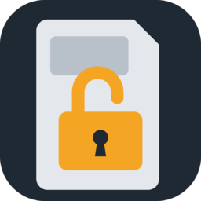
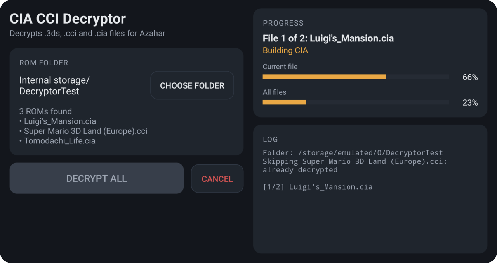
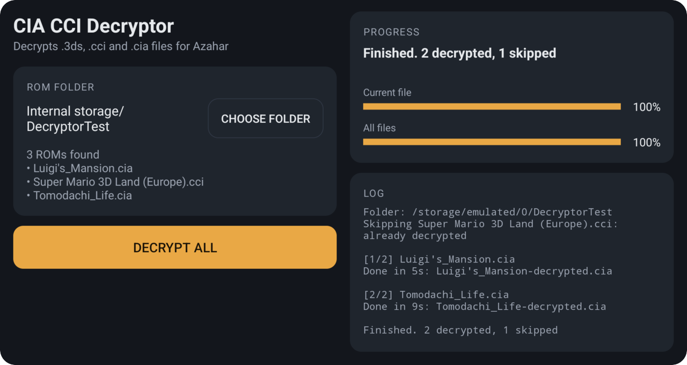
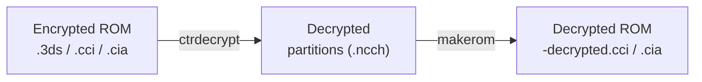

<p align="center">
  
</p>

<h1 align="center">CIA CCI Decryptor</h1>

<p align="center">
  Batch-decrypt Nintendo 3DS games, updates and DLC (<code>.3ds</code> · <code>.cci</code> · <code>.cia</code>) for <a href="https://azahar-emu.org">Azahar</a>,<br>
  on your Linux PC or directly on your Android handheld.
</p>

<p align="center">
  <a href="https://github.com/lillyschulte/CIA-CCI-Decryptor/releases/latest"></a>
  <a href="https://github.com/lillyschulte/CIA-CCI-Decryptor/releases"></a>
  
  
  <a href="LICENSE"></a>
</p>

<p align="center">
  <a href="https://github.com/lillyschulte/CIA-CCI-Decryptor/releases/latest"><b>Download the Android app</b></a>
  &nbsp;·&nbsp;
  <a href="#linux">Linux setup</a>
  &nbsp;·&nbsp;
  <a href="#how-it-works">How it works</a>
  &nbsp;·&nbsp;
  <a href="#credits">Credits</a>
</p>

<p align="center">
  
  &nbsp;
  
</p>
<p align="center"><sub>The Android app running on an AYN Thor</sub></p>

---

## Features

- **Every 3DS format.** Game, update and DLC CIAs, plus `.3ds`/`.cci` cartridge dumps
- **Detects the title type** (game / update / DLC) and rebuilds each one correctly
- **Azahar-ready output.** Decrypted CIAs install in Azahar; cartridge dumps come out as decrypted, trimmed `.cci` files
- **Keeps the title version**, so updates are recognised properly
- **Seed-encrypted titles** are handled with a bundled seed database, with an online fallback
- **Safe to re-run.** Files that are already decrypted, or already have a decrypted copy, are skipped
- **Two ways to run it.** A one-command script on Linux, or a standalone Android app

> [!NOTE]
> Azahar uses the `.cci` extension, which is the real name of the format used by `.3ds` files.

## Android app

A standalone app for arm64 Android devices, designed for handhelds like the AYN Thor. It decrypts ROMs on the device itself: no PC needed.

<table>
<tr>
<td width="50%" valign="top">

**Install**

1. [Download the APK](https://github.com/lillyschulte/CIA-CCI-Decryptor/releases/latest) and install it
2. Open **CIA CCI Decryptor** and tap **Allow access** to grant "All files access"
3. Tap **Choose folder** and pick your 3DS ROM folder
4. Tap **Decrypt all**

</td>
<td width="50%" valign="top">

**What you get**

- Folder on internal storage or SD card, remembered between launches
- Current file and stage, with per-file and overall progress bars
- Keeps running in the background, with a progress notification
- Can be cancelled at any time without leaving partial files behind
- Games saved as `.cci` so they appear in Azahar's game list
- Settings to delete encrypted originals and sort updates and DLC into their own folder

</td>
</tr>
</table>

Decrypted copies are written next to the originals, using the [same names as on Linux](#output-files), except that games are saved as `Game-decrypted.cci` by default so they show up in Azahar's game list (which ignores `.cia` files). Updates and DLC are always `.cia`, since Azahar installs them.

The settings screen (gear button) has these options:

| Setting | Default | |
| --- | --- | --- |
| Save games as .cci | On | Turn off to keep games as `.cia` |
| Delete encrypted originals | Off | Deletes each original once its decrypted copy has been written |
| Sort updates and DLC into a folder | Off | Saves decrypted updates and DLC to `Updates and DLC` in the ROM folder, or a folder you choose |

The app's source and build instructions are on the [`android` branch](https://github.com/lillyschulte/CIA-CCI-Decryptor/tree/android/android).

> [!TIP]
> Requires Android 11 or newer on a 64-bit ARM device. The app needs "All files access" so it can read and write ROMs in any folder.

## Linux

### Requirements

- Linux x86_64
- Rust/cargo, `curl` and `unzip`

```bash
sudo dnf install cargo unzip      # Fedora
sudo apt install cargo unzip      # Debian/Ubuntu
sudo pacman -S rust unzip         # Arch
```

### Setup

```bash
git clone https://github.com/lillyschulte/CIA-CCI-Decryptor
cd CIA-CCI-Decryptor
./setup.sh
```

`setup.sh` builds `ctrdecrypt` and `dlchelper` into `bin/` and downloads the Linux builds of `ctrtool` and `makerom` from [Project_CTR](https://github.com/3DSGuy/Project_CTR/releases). Existing `ctrtool`/`makerom` binaries in `bin/` are kept (delete them to download again), and the tools are also looked up on your `PATH`.

### Usage

Put your CIA, 3DS or CCI files in the folder containing `decrypt.sh` and run it, or point it at another folder:

```bash
./decrypt.sh                    # decrypt everything next to the script
./decrypt.sh /path/to/games     # decrypt everything in another folder
```

### Output files

Decrypted files are written next to the originals:

| Input | Output |
| :--- | :--- |
| `Game.3ds` / `Game.cci` | `Game-decrypted.cci` |
| Game CIA | `Game-decrypted.cia` |
| Update CIA | `Game (Update)-decrypted.cia` |
| DLC CIA | `Game (DLC)-decrypted.cia` |

<details>
<summary><b>Debug mode</b></summary>
<br>

```bash
./decrypt.sh --debug
```

Shows each command and its output, writes the `ctrdecrypt` log to `log.txt`, and processes files even if they already look decrypted. Use this if a file doesn't produce any output.

</details>

## How it works

Both versions run the same two-step pipeline for each ROM:



1. **`ctrdecrypt`** decrypts each partition of the ROM (including seed crypto) into temporary `.ncch` files
2. **`makerom`** rebuilds them into a decrypted CCI or CIA, keeping the title version, then the temporary files are removed

The title type and version are read from the ROM's headers. On Linux, `ctrtool` and `dlchelper` do this; the Android app reads the headers itself.

### Seeds

Some titles use seed crypto. `ctrdecrypt` looks up seeds in the bundled `seeddb.bin` and, if a seed is missing, tries to fetch it from Nintendo's servers (this needs an internet connection).

## Credits

| Component | Author |
| :--- | :--- |
| Batch CIA CCI Decryptor (Windows original) | [rcyggdra](https://github.com/rcyggdra/decryptor) |
| Batch CIA 3DS Decryptor | [matiffeder](https://github.com/matiffeder/3DS-stuff) ([original thread](https://gbatemp.net/threads/batch-cia-3ds-decryptor-a-simple-batch-file-to-decrypt-cia-3ds.512385/)) |
| `ctrtool` / `makerom` | [3DSGuy](https://github.com/3DSGuy/Project_CTR) |
| `seeddb.bin` | [ihaveamac](https://github.com/ihaveamac/3DS-rom-tools/tree/master/seeddb) |
| `ctrdecrypt` | [shijimasoft](https://github.com/shijimasoft/ctrdecrypt) & [R-YaTian](https://github.com/R-YaTian/ctrdecrypt) |
| `dlchelper` | [R-YaTian](https://github.com/R-YaTian/3DS-Converters/tree/master/dlchelper) |

Linux and Android ports by [lillyschulte](https://github.com/lillyschulte).

## License

Released under the [MIT License](LICENSE).

<sub>Only decrypt games you own. This project is not affiliated with or endorsed by Nintendo.</sub>
